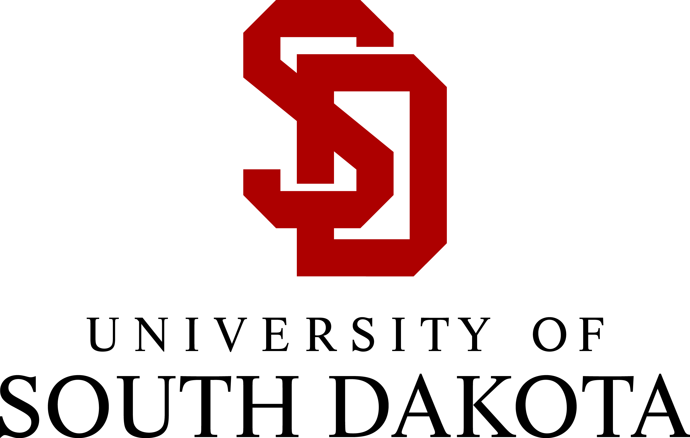

## University of South Dakota

**Bachelor of Science in Computer Science**
2014–2018 · GPA: 3.6

**Minor in Business Administration**

My undergraduate studies combined software development and computer science fundamentals with practical experience working in teams and solving technical problems.

## Core areas of study

- **Algorithms and data structures:** organizing information and reasoning about efficient solutions.
- **Discrete structures:** logic, sets, relations, and mathematical foundations used in computing.
- **Machine learning:** introductory concepts for building systems that learn from data.
- **Software engineering:** designing, building, and delivering a team-based capstone project.
- **Unix environments:** working with command-line tools and operating-system concepts.

## Activities and recognition

- Dean’s List, Spring and Fall 2017
- Association for Computing Machinery
- National Collegiate Cyber Defense Competition

## Education profile

Here’s my undergraduate record represented as structured data:


```json
{
  "Universities": {
    "name": "University of South Dakota",
    "alias": "USD",
    "degrees": {
      "major": {
        "name": "Computer Science",
        "start_date": "2014-08-01",
        "end_date": "2018-05-01",
        "status": "completed",
        "gpa": "3.6",
        "courses": [
          "CSC 324 Machine Learning",
          "Math 216 Discrete Structures",
          "CSC 350 Algorithms and Data Structures",
          "CSC 480 Capstone Software Engineering",
          "CSC 492 Unix Environment"
        ]
      },
      "minor": {
        "name": "Business Administration",
        "end_date": "2018-05-01",
        "status": "completed"
      },
      "accomplishments": {
        "name": "Dean's List",
        "date": ["Spring 2017", "Fall 2017"]
      },
      "clubs": [
        {
          "id": 1,
          "name": "Association for Computing Machinery"
        },
        {
          "id": 2,
          "name": "National Collegiate Cyber Defense Competition"
        }
      ]
    }
  }
}
```

